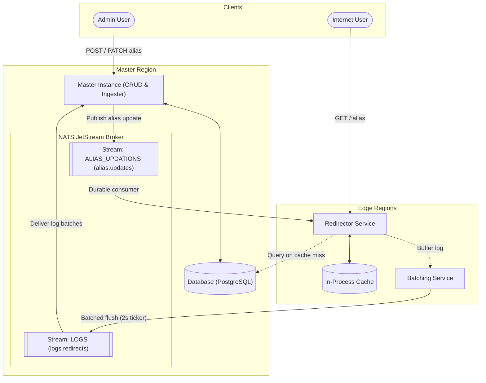
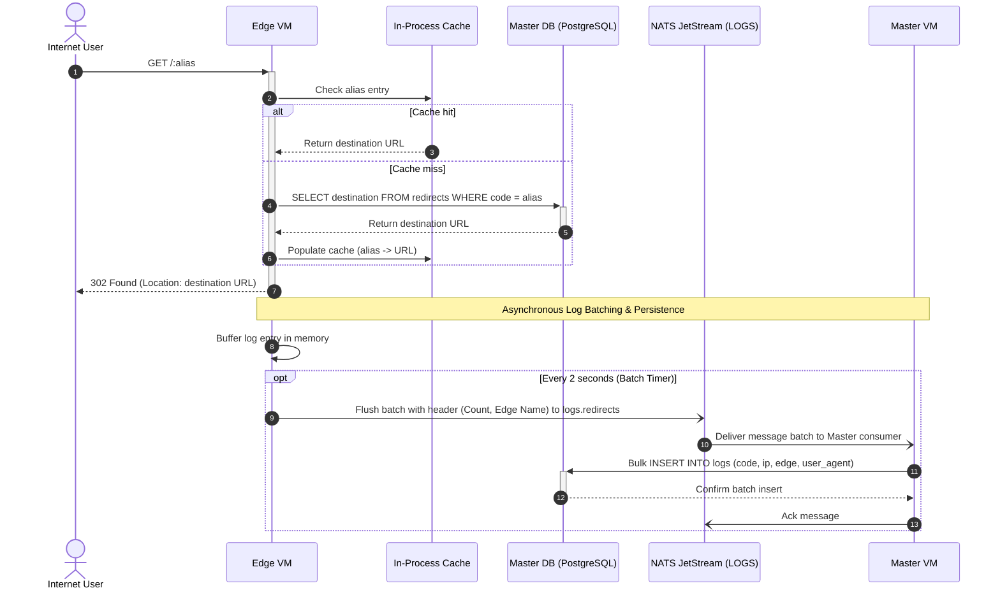
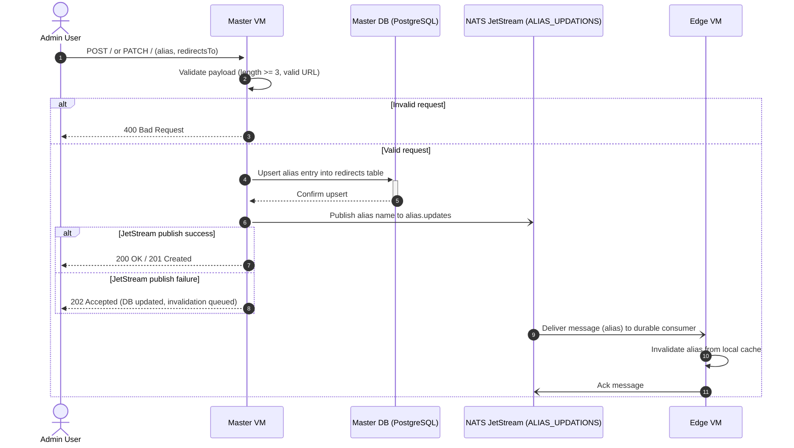
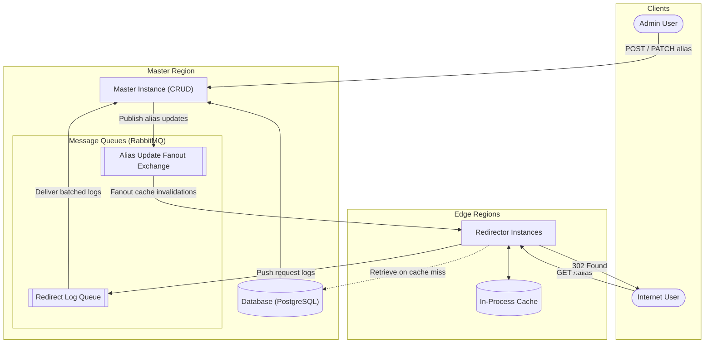
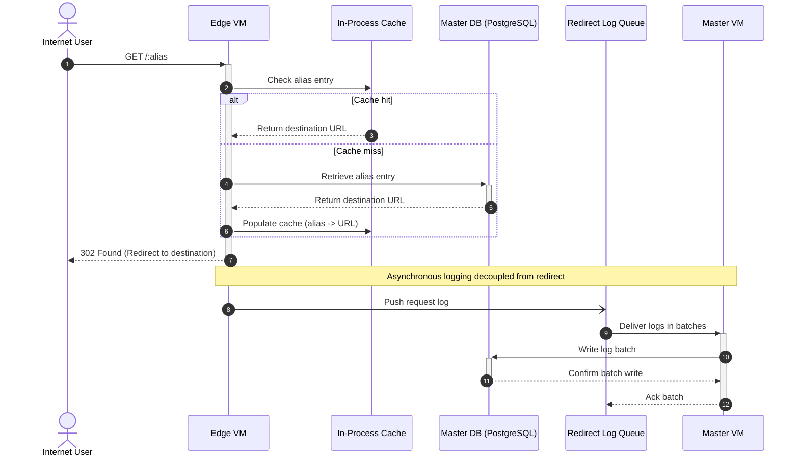
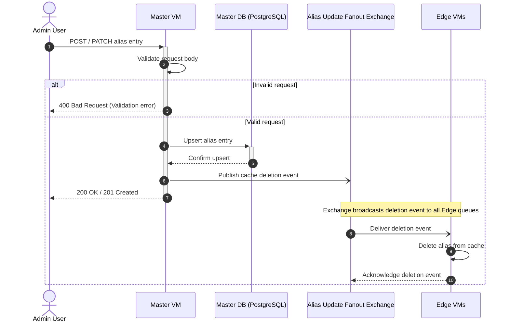
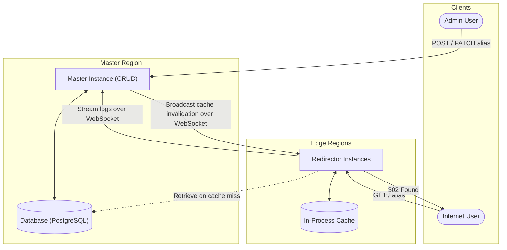
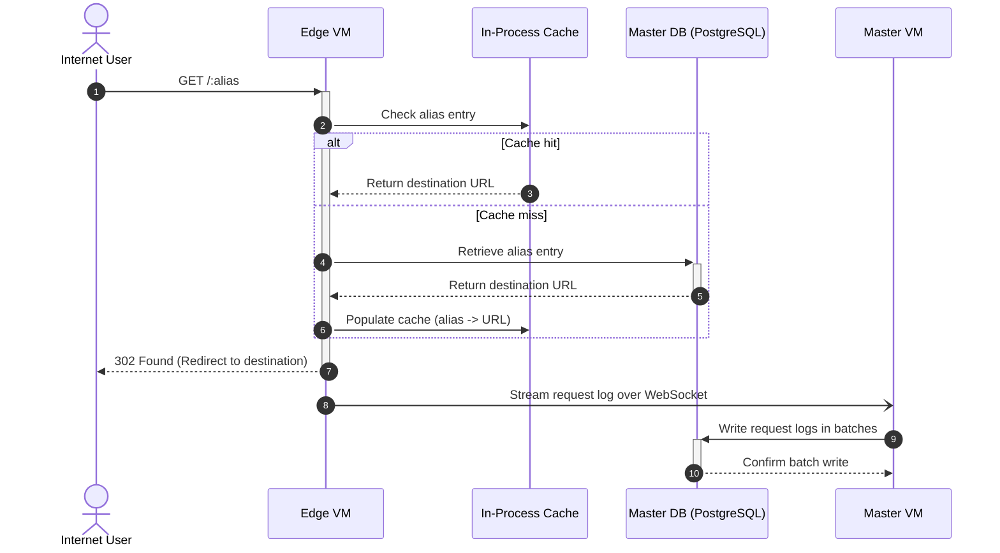
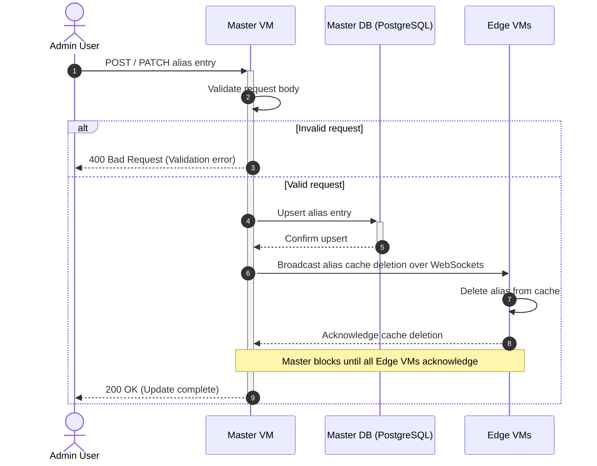

# URL Shortener

__PS:__ docs are generated, code is hand-written :)

## Requirements

- 1 billion redirects per day (~11.6k per sec)
- Redirect P99 latency < 100ms (or as fast as I can make it)
- No CDN Caching, Only Anycast DNS + Edge VMs
- No permanent redirects as we need analytics

```sh
# Fetching an alias
GET /<alias>

# Creating an alias
POST /

# Updating an alias
PATCH /
```

## Revisions

### Revision 3 (Messaging System instead of Queue)

- NATS Messaging system instead of message queue
- with JetStream to add persistence
- for alias updates,
    - MQs (RabbitMQ) require awkward Exchange with Fanout
    - NATS supports multiple consumer delivery on single stream
- for redirect logs,
    - Kafka suits long persistence or multiple consumers on high load
    - Consumer is always single master
    - Long retention is not required
    - Instead, edge nodes will perform batching



#### Redirection Flow

1. Users on Internet send `GET /:alias`, received by Edge VM.
2. Edge VM checks its local in-process cache (sync.Map, 100k capacity).
3. If not found, Edge VM retrieves the alias entry from Master DB and populates its local cache.
4. Edge VM immediately responds with `302 Found` (with destination URL) to the user.
5. In the background, the request log is buffered in memory.
6. A background ticker (every 2s) prepends a JSON header (`count`, `edge` hostname) and flushes the batched logs to NATS JetStream `logs.redirects`.
7. Master VM consumer receives log batches and performs a single bulk multi-row `INSERT INTO logs`.
8. Master VM acknowledges the message batch to JetStream.



#### Alias Entry Update Flow

1. Admin User performs REST (`POST /` or `PATCH /`) to Master VM.
2. Master VM validates request body (alias length >= 3, valid destination URL).
3. Master VM upserts alias entry into Master PostgreSQL DB.
4. Master VM publishes cache invalidation event to NATS JetStream stream `ALIAS_UPDATIONS` on subject `alias.updates`.
5. Master VM responds to Admin User (`200 OK` / `201 Created`, or `202 Accepted` if event publishing failed).
6. NATS JetStream delivers invalidation event to Edge VM's durable consumer.
7. Edge VM removes the alias from its in-process cache and acknowledges the message to JetStream.



### Revision 2 (Message Queue instead of WebSockets)

- 2 queues for redirect logs & alias updates in Master region
- For redirect logs,
    - log redundancy in case of Master node failure
    - batching of redirect logs before write
- For alias updates,
    - Needs Exchange with Fanout strategy



#### Redirection Flow

1. Users on Internet `GET /:alias`, received by Edge VM.
2. Edge VM checks its cache for the alias entry.
3. If not found, Edge VM retrieves alias entry from Master DB and populates local cache.
4. Edge VM responds with 302 redirect to Internet traffic.
5. Edge VM pushes log to Message queue asynchronously.
6. Master VM receives logs from Message Queue in batches.
7. Master VM writes these batched logs to Master DB.



#### Alias Entry Update Flow

1. Admin User performs REST (POST/PATCH) to Master VM.
2. Master VM validates request body and upserts to Master DB.
3. Master VM pushes alias cache deletion event to Message queue (Fanout Exchange).
4. Master VM responds to Admin User immediately.
5. Edge VMs receive deletion event from Fanout Exchange.
6. Edge VMs delete cache entry and ack to message queue.



### Revision 1 (WebSockets & In-process caching)

- In-Process cache following Cache-aside



#### Redirection Flow

1. Users on Internet `GET /:alias`, received by Edge VM.
2. Edge VM checks its cache for the alias entry.
3. If not found, Edge VM retrieves alias entry from Master DB and populates local cache.
4. Edge VM responds with 302 redirect to Internet traffic.
5. Edge VM sends log for this request to Master VM through WebSockets.
6. Master VM writes these logs in batches to Master DB.



#### Alias Entry Update Flow

1. Admin User performs REST (POST/PATCH) to Master VM.
2. Master VM validates request body and upserts to Master DB.
3. Master VM sends alias cache deletion event to Edge VMs via WebSockets.
4. Edge VMs send ack and Master VM marks the update as complete.



### Revision 0

Single Go executable with SQLite.

### Planned Optimizations

- [X] Batch logs in edge
- [X] Header to replace duplicated payload from logs
- [ ] Replace JSON serialization for logs
- [ ] Reduce Edge database calls with requests to Master
- [ ] Workaround for NATS 1mb message size restriction
- [ ] Persist batched logs on disk and retry to handle NATS network partition
- [ ] Seprate LSM Style DB for redirect logs
- [ ] Prefiling Edge cache?
