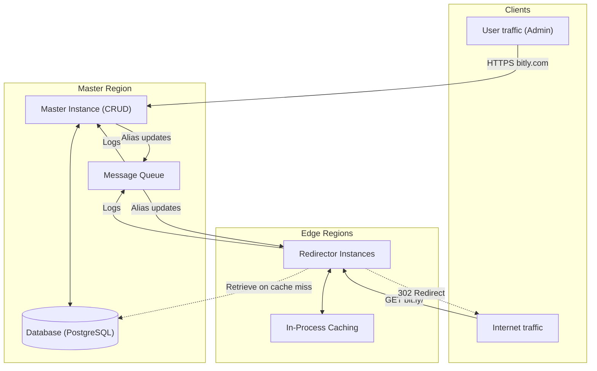
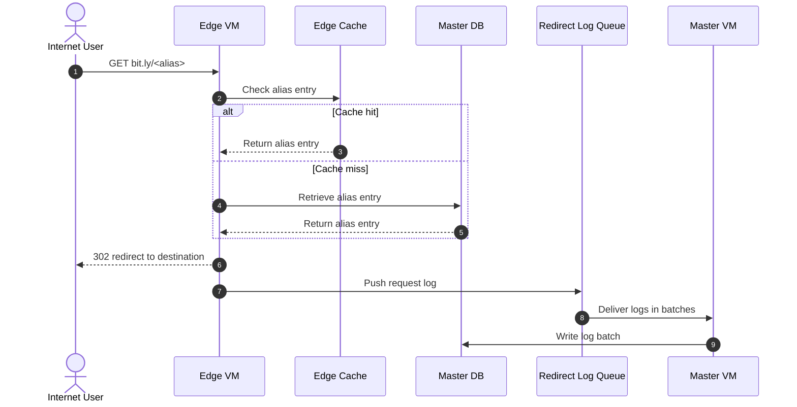
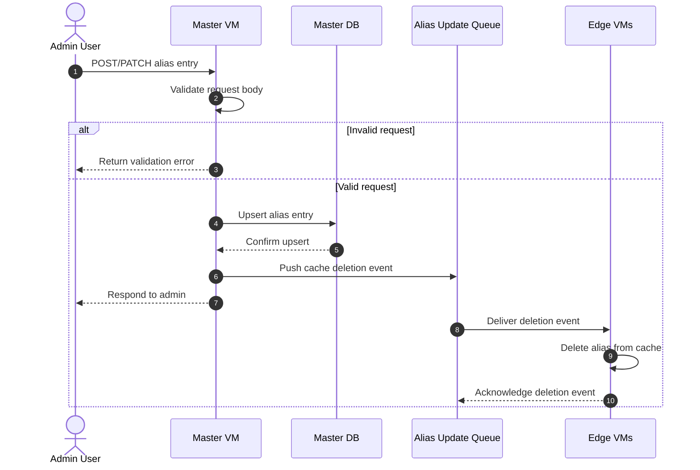
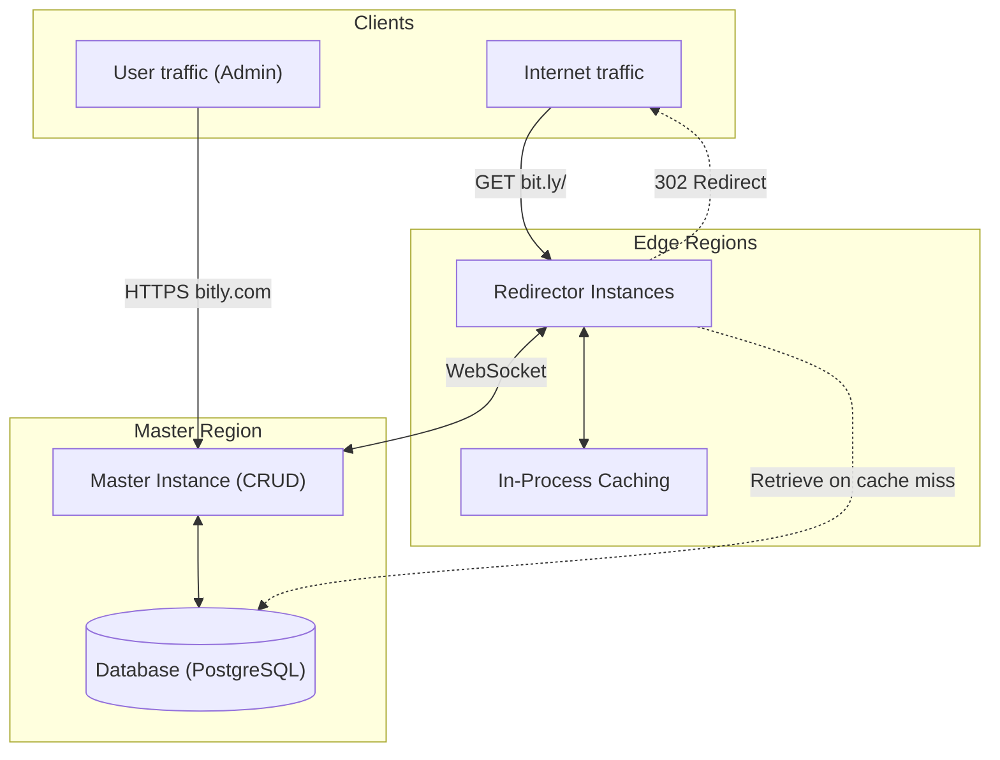
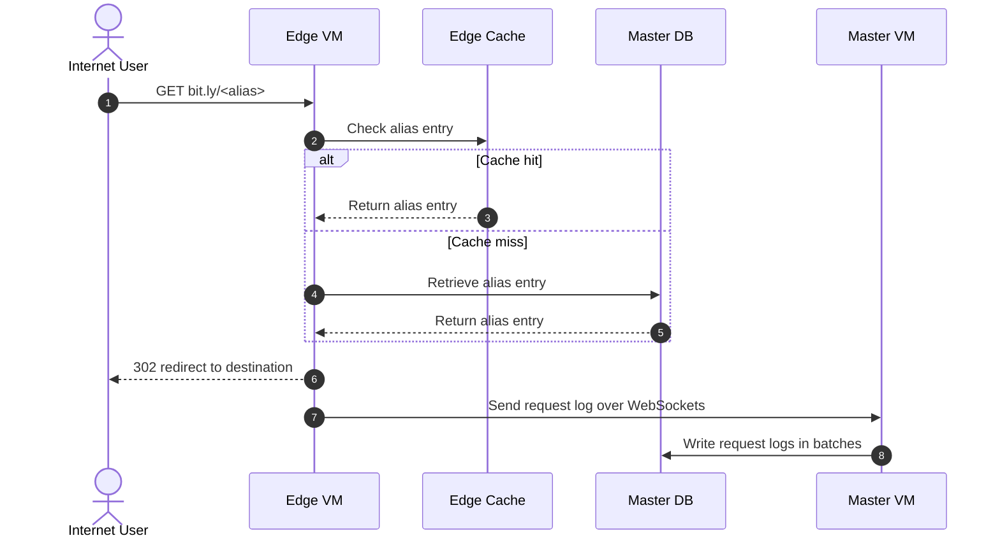
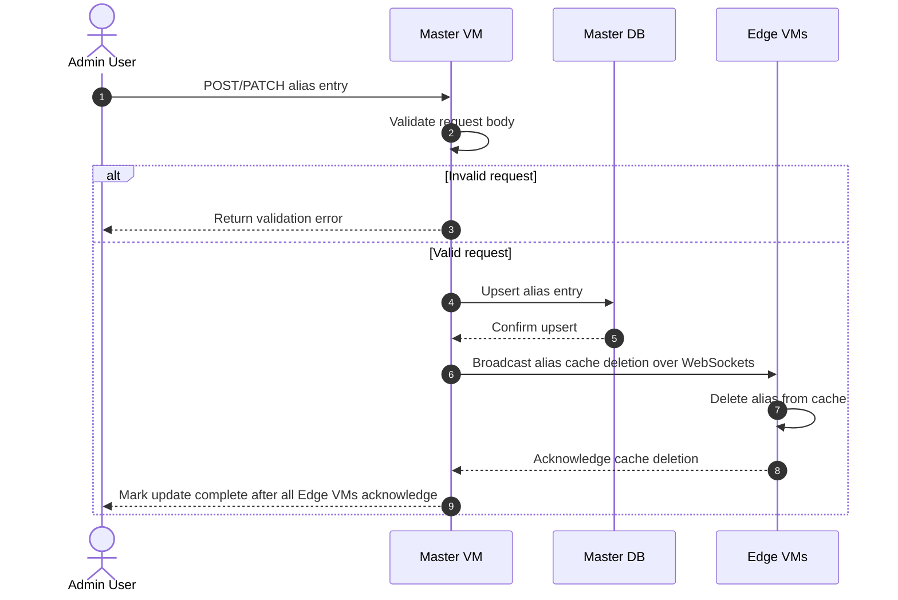

# URL Shortener

## Requirements

- 1 billion redirects per day (~11.6k per sec)
- Redirect latency < 300ms (or as fast as I can make it)
- No permanent redirects as we need analytics

```sh
# Fetching an alias
GET /<alias>

# Creating an alias
POST /

# Updating an alias
PATCH /
```

## Revisions

### Revision 3 (Messaging System instead of Queue)

- NATS Messaging system instead of message queue
- with JetStream to add persistence
- for alias updates,
    - MQs (RabbitMQ) require awkward Exchange with Fanout
    - NATS supports multiple consumer delivery on single stream
- for redirect logs,
    - Kafka suits long persistence or multiple consumers on high load
    - Consumer is always single master
    - Long retention is not required
    - Instead, edge nodes will perform batching

### Revision 2 (Message Queue instead of WebSockets)

- 2 queues for redirect logs & alias updates in Master region
- For redirect logs,
    - log redundancy in case of Master node failure
    - batching of redirect logs before write
- For alias updates,
    - Needs Exchange with Fanout strategy



#### Redirection Flow

1. Users on Internet `GET bit.ly/<alias>`, received by Edge VM.
2. Edge VM checks its cache for the alias entry.
3. If not found, Edge VM retrieves alias entry from Master DB.
4. Edge VM responds with 302 redirect to Internet traffic.
5. Edge VM pushes log to Message queue.
6. Master VM receives logs from Message Queue in batches.
7. Master VM writes these batched logs to Master DB.



#### Alias Entry Update Flow

1. Admin User performs REST (POST/PATCH) to Master VM.
2. Master VM validates request body and upserts to Master DB.
3. Master VM pushes alias cache deletion event to Message queue.
4. Master VM responds to Admin User at this point.
5. Edge VMs receive deletion event from Message queue.
6. Edge VMs delete cache entry and ack to message queue.



### Revision 1 (WebSockets & In-process caching)

- In-Process cache following Cache-aside



#### Redirection Flow

1. Users on Internet `GET bit.ly/<alias>`, received by Edge VM.
2. Edge VM checks its cache for the alias entry.
3. If not found, Edge VM retrieves alias entry from Master DB.
4. Edge VM responds with 302 redirect to Internet traffic.
5. Edge VM sends log for this request to Master VM through WebSockets.
6. Master VM writes these logs in batches to Master DB.



#### Alias Entry Update Flow

1. Admin User performs REST (POST/PATCH) to Master VM.
2. Master VM validates request body and upserts to Master DB.
3. Master VM sends alias cache deletion event to Edge VMs via WebSockets.
4. Edge VMs send ack and Master VM marks the update as complete.



### Revision 0

Single Go executable with SQLite.

## Optimizations

- [X] Batch logs in edge
- [X] Header to replace duplicated payload from logs
- [ ] Persist batched logs on disk and retry to handle NATS downtime
