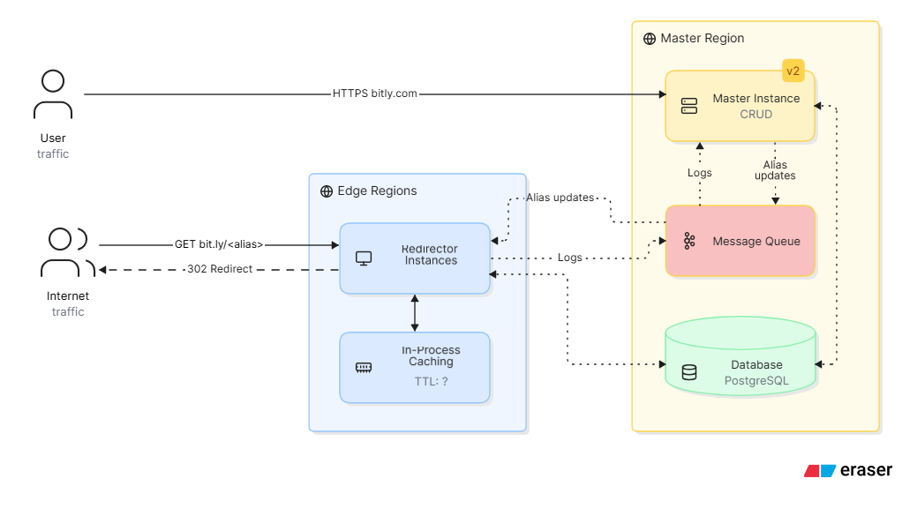
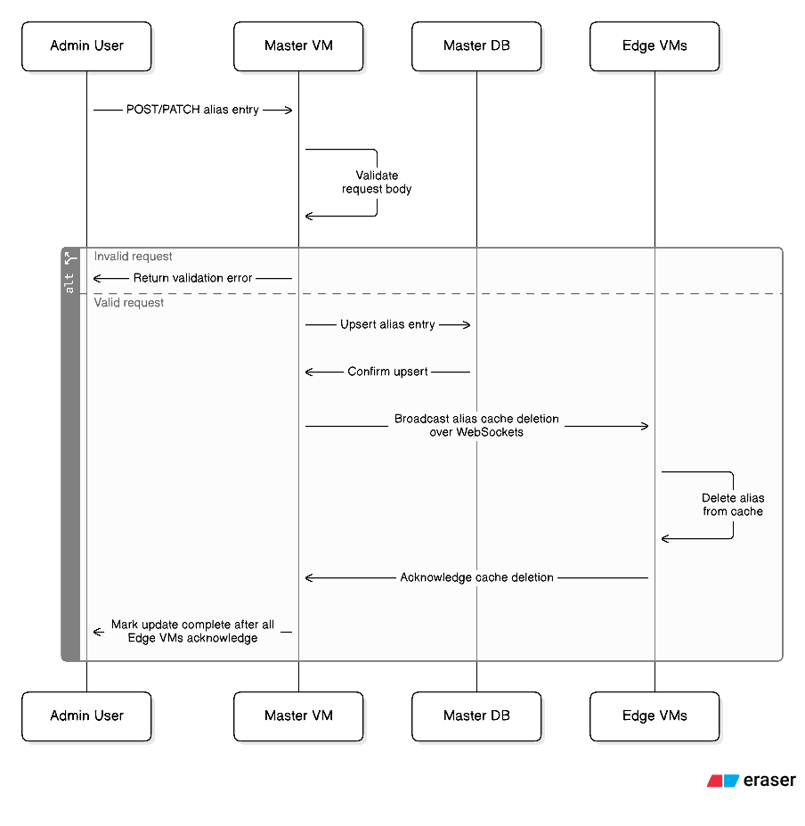
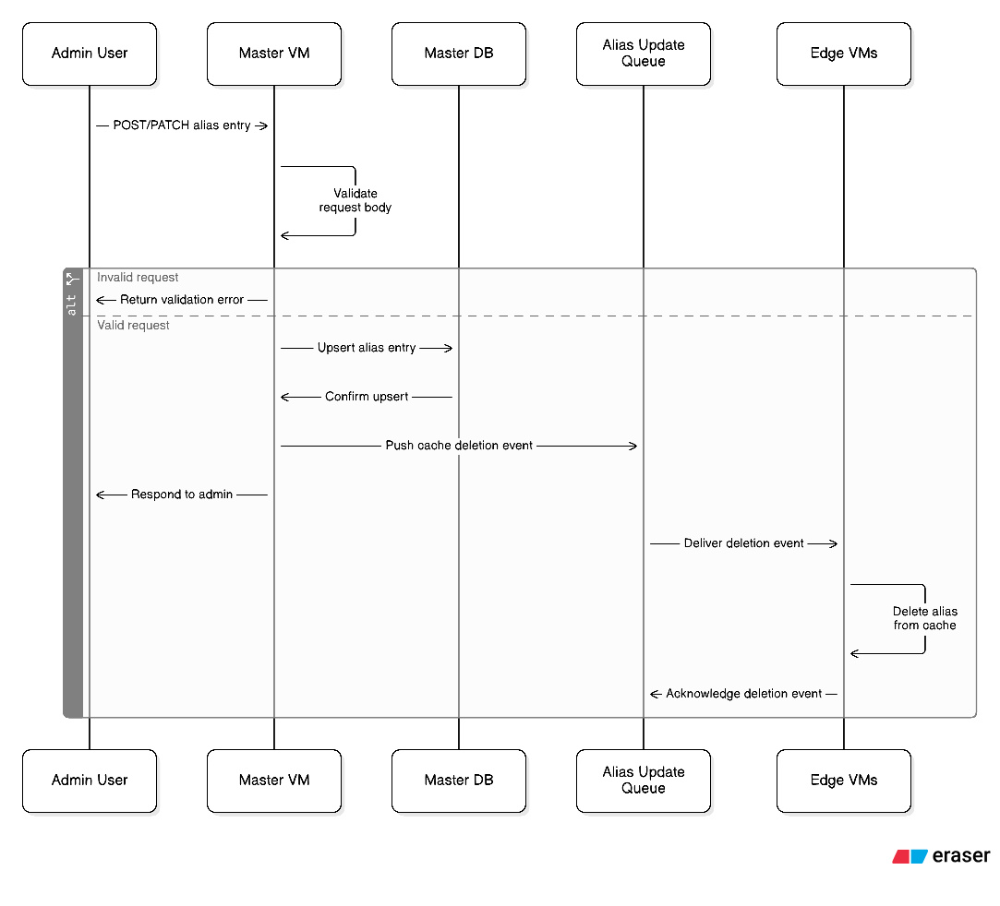
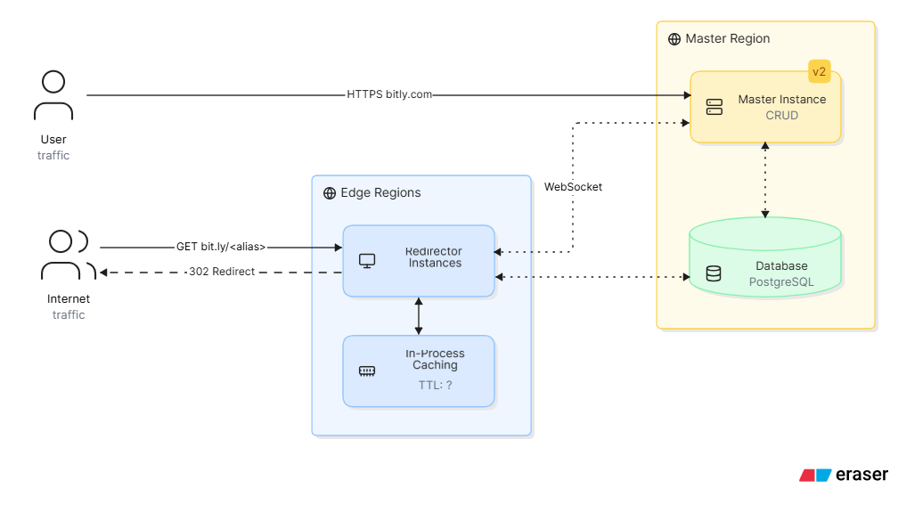
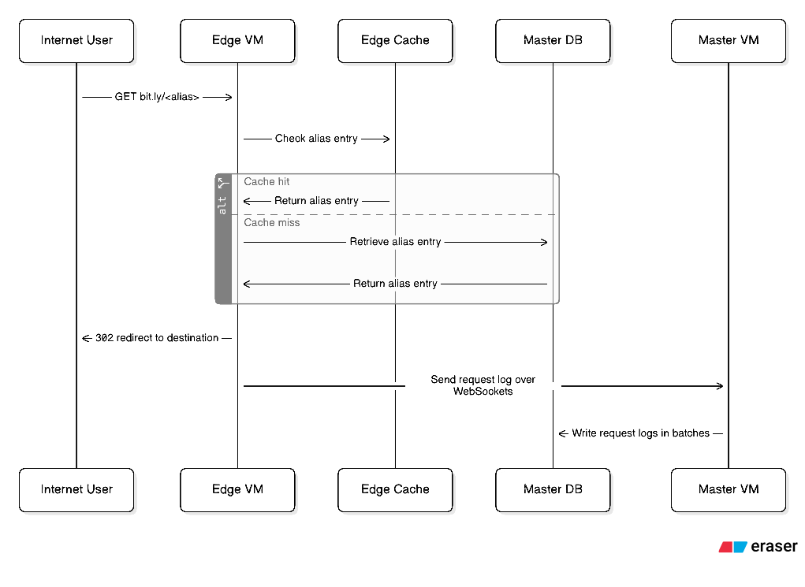
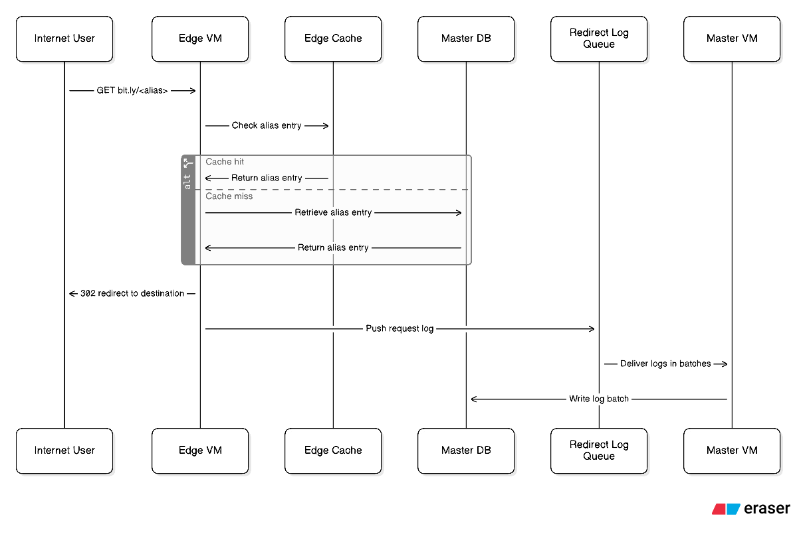

# URL Shortner

## Revision 2 (Message Queue instead of WebSockets)

- 2 queues for redirect logs & alias updation in Master region
- For redirect logs,
    - logs redundancy incase of Master node failure
    - batching of redirect logs before write
- For alias updates,
    - Needs Exchange with Fanout strategy

### Redirection Flow

1. Users on Internet `GET bit.ly/<alias>`, received by Edge VM.
2. Edge VM checks its cache for the alias entry
3. If not found, Edge VM retrives alias entry from Master DB
4. Edge VM responds with 302 redirect to Internet traffic
5. Edge VM pushes log to Message queue
6. Master VM receives log from Message Queue in batches
6. Master VM writes these batches logs to Master DB

### Alias Entry Updation Flow

1. Admin User perform REST (POST/PATCH) to Master VM
2. Master VM validates request body and upserts to Master DB
3. Master VM pushes alias cache deletion event Message queue.
4. Master VM responds to Admin User at this point
5. Edge VMs receives deletion event from Message queue.
6. Edge VMs delete cache entry and ack to message queue.

## Revision 1 (WebSockets & In-process caching)

- In-Process cache following Cache aside

### Redirection Flow

1. Users on Internet `GET bit.ly/<alias>`, received by Edge VM.
2. Edge VM checks its cache for the alias entry
3. If not found, Edge VM retrives alias entry from Master DB
4. Edge VM responds with 302 redirect to Internet traffic
5. Edge VM sends log for this request to Master VM through WebSockets
6. Master VM writes these logs in batchs to Master DB

### Alias Entry Updation Flow

1. Admin User perform REST (POST/PATCH) to Master VM
2. Master VM validates request body and upserts to Master DB
3. Master VM sends alias cache deletion event to Edge VMs via WebSockets.
4. Edge VMs sends ack and Master VM marks the updation to be complate.

## Revision 0

Single go executable with sqlite.
